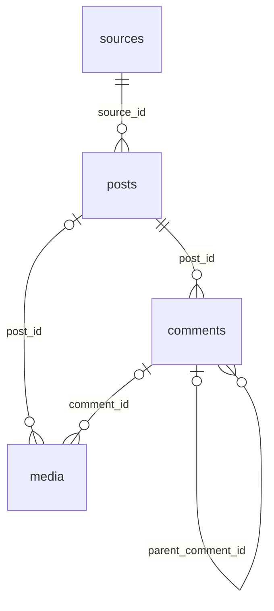

# Database: sources, posts, comments, media

Schema thực thi nằm trong [schema.sql](../fb_scraper/storage/schema.sql). Database
chỉ có bốn bảng nghiệp vụ; `sqlite_sequence` do SQLite tự quản lý AUTOINCREMENT.



Một dòng `media` chỉ thuộc **một bài hoặc một bình luận**, được kiểm tra bằng CHECK.
Không có bảng `profiles`, `groups` hoặc `search_results` ở phiên bản mới.

## Định danh và quan hệ

| Cột | Ý nghĩa |
| --- | --- |
| `sources.id`, `posts.id`, `comments.id`, `media.id` | Khóa chính số nguyên do SQLite cấp |
| `posts.source_id` | Khóa ngoại đến `sources.id` |
| `posts.post_key` | Định danh Facebook, UNIQUE |
| `comments.post_id` | Khóa ngoại đến `posts.id`, không phải post_key |
| `comments.comment_key` | Định danh bình luận Facebook, UNIQUE |
| `comments.parent_comment_id` | Khóa ngoại đến `comments.id` của cha trực tiếp |
| `comments.parent_comment_key` | Khóa Facebook của cha; giữ khi cha chưa được đọc để nối FK sau |
| `comments.root_comment_key` | Khóa Facebook của bình luận gốc của luồng |
| `posts.original_post_key` | Khóa Facebook của bài gốc được chia sẻ, có thể chưa được thu thập |

Reply được chèn theo hai lượt: lưu các bản ghi trước, sau đó nối FK. Nếu cha xuất
hiện ở lần thu thập sau, FK của các reply đang chờ được cập nhật. Không tạo bình
luận cha giả. Nếu chỉ biết gốc luồng, giữ `root_comment_key` và `is_reply=1`, để
`parent_comment_id=NULL`. Không suy ra cha trực tiếp từ tên người được nhắc trong text.
Trigger và storage từ chối cha thuộc bài khác hoặc quan hệ tạo chu kỳ.

ID base64 `comment:<post>_<comment>` và ID số được chuẩn hóa về cùng comment_key.
Bình luận cũ chỉ có text dùng khóa `local:...`, giữ trạng thái quan hệ chưa xác định.

## Cột bổ sung

Các cột gốc của SQL yêu cầu được giữ. Những cột sau bổ sung để giữ các chức năng hiện có:

| Bảng | Cột bổ sung |
| --- | --- |
| `sources` | `metadata`: thông tin Giới thiệu và `search_history` |
| `posts` | `url`, `author`, `author_url`, `posted_raw`, `reaction_count`, `comment_count`, `share_count`, `metadata` |
| `comments` | `author`, `author_url`, `url`, `created_raw`, `parent_comment_key`, `root_comment_key`, `is_reply` |
| `media` | `media_url`, `metadata` |

`sources.source_type` phân biệt `profile`, `page`, `group`. Từ khóa là cách tìm bài,
được giữ ở `posts.metadata.source` dạng `kw:...`; không được lưu giả thành một Trang.
Khi chưa biết nguồn, dùng `source_ref=unresolved:<post_key>` cùng metadata đánh dấu
chưa xác định; không bịa URL Facebook. Với tài khoản chưa phân biệt được Trang/cá nhân,
collector tạm dùng `profile`; chọn chế độ Trang hoặc đọc Giới thiệu sẽ xác định lại.

`posts.collected_at` giữ lần lưu đầu, `last_seen_at` cập nhật khi đọc/lưu lại. Các trường
không đọc được để NULL; DEFAULT 0 của SQL vẫn áp dụng khi bỏ cột trong câu INSERT.

## Media và OCR

Mỗi ảnh/video/GIF là một dòng, giữ `position`. Ảnh tải về có `file_path` và hash SHA-256
trong `file_hash`. OCR chính nằm ở `ocr_text`; chi tiết URL/số điện thoại OCR nhận diện
được giữ trong `metadata.ocr`. Media bình luận tham chiếu `comment_id`, không gắn đồng thời
vào post_id. URL video trực tiếp có thể được lưu khi DOM cung cấp; đường dẫn blob/stream
không được giả thành file đã tải. `file_path=NULL` nghĩa là chưa tải media về máy.

## Chuyển dữ liệu cũ

Lần mở đầu tiên tự tạo `posts.before-v3-<mã>.db` bằng SQLite backup, sau đó chuyển dữ liệu
trong một transaction. Nguồn được khử trùng theo URL; thông tin profiles/groups chuyển vào
`sources.metadata.entity`. Lịch sử tìm kiếm chuyển vào `sources.metadata.search_history`.
Nếu chuyển thất bại, rollback cả DDL lẫn dữ liệu và giữ bản sao; không xóa database để tạo lại.
Database đã tạo trực tiếp từ bốn bảng SQL gốc cũng được bổ sung cột mà không thay ID cũ.

`PRAGMA foreign_keys=ON` áp dụng cho mỗi kết nối ghi của ứng dụng. Kiểm tra thủ công:

```sql
PRAGMA foreign_key_check;
PRAGMA integrity_check;

SELECT p.id, p.post_key, s.source_type, s.source_label, p.content
FROM posts p JOIN sources s ON s.id = p.source_id;

SELECT c.id, c.comment_key, c.author, c.content,
       parent.comment_key AS parent_key, parent.content AS parent_content
FROM comments c
LEFT JOIN comments parent ON parent.id = c.parent_comment_id
WHERE c.post_id = 1
ORDER BY c.id;

SELECT m.*, p.post_key, c.comment_key
FROM media m
LEFT JOIN posts p ON p.id=m.post_id
LEFT JOIN comments c ON c.id=m.comment_id;
```

## JSONL và model Python

`sources.jsonl`, `posts.jsonl`, `comments.jsonl`, `media.jsonl` dùng tên cột và ID của
schema mới. `posts.jsonl` bổ sung `source_record`, `comments`, `media` để đọc một bài
và các bản ghi liên quan trong một dòng. `data_agent.json` dùng cùng định dạng.

Model thu thập `Post`/`Comment` là DTO trung gian: `post_id` và `comment_id` trong
collector/agent là khóa Facebook; `text` là nội dung. Storage ánh xạ sang `post_key`,
`comment_key`, `content` và FK số. `load_post()` cung cấp projection cho pipeline;
`post_record()` trả bản ghi chuẩn hóa. Giao diện dùng `comment_records` với ID số
để dựng cây reply, không dùng tên hoặc vị trí text để đoán quan hệ.

Các file `profiles.jsonl`, `groups.jsonl`, `search_results.jsonl` còn lại từ phiên bản cũ
được giữ để đối chiếu; bản mới không cập nhật chúng. Lệnh xuất lại bốn snapshot:

```powershell
.\Demo_Fb_scraper\.venv\Scripts\python.exe .\Demo_Fb_scraper\main.py storage --export-jsonl
```
