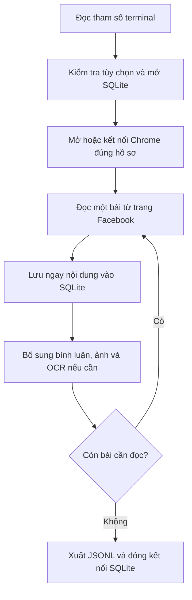

# Hướng dẫn đọc code

Code Python của project dùng các bước xử lý riêng: kiểm tra đầu vào, tạo danh
sách/dictionary, lặp qua từng phần tử, rồi trả kết quả. Các phần xử lý dữ liệu
đã được viết bằng `for`, `if/else` và biến trung gian có tên.

Các thư viện điều khiển trình duyệt vẫn cần một số kiến thức ngoài cú pháp cơ
bản. Tài liệu này giải thích chúng theo đúng chỗ đang dùng trong project.

## 1. Bắt đầu đọc từ đâu?

Mở `main.py` ở thư mục gốc trước. Ví dụ lệnh:

```powershell
.\Demo_Fb_scraper\.venv\Scripts\python.exe .\Demo_Fb_scraper\main.py posts --max-posts 20 --comments 5
```

`main.py` nhận lệnh `posts` và chuyển các tùy chọn phía sau cho
`fb_scraper/posts/collector.py`. Lệnh `entity`, `search`, `agent`,
`browser`, `storage` cũng đi tới phần xử lý tương ứng.

Để xem phần nhận tùy chọn thu thập bài, mở `fb_scraper/posts/collector.py`, đi xuống cuối file:

```python
def run_cli(argv=None):
    parser = argument_parser()
    args = parser.parse_args(argv)
    asyncio.run(main(args))
```

Ví dụ trên lược bớt phần bắt lỗi để tập trung vào luồng chạy:

1. `run_cli(argv)`: đọc các tùy chọn terminal mà `main.py` chuyển tới.
2. `argument_parser()`: khai báo những tham số được phép nhập trên terminal.
3. `parse_args(argv)`: đọc tham số người dùng đã nhập.
4. `asyncio.run(main(args))`: bắt đầu thực hiện công việc chính.

Chỉ `main.py` có `if __name__ == "__main__"`. Trước khi gọi `run_cli()`, `main.py`
thiết lập terminal UTF-8 và nạp `.env` một lần (`fb_scraper/common/runtime.py`),
nên các module con không tự làm lại hai việc này.

Với lệnh `main.py posts --max-posts 20 --comments 5`, `args.max_posts`
có giá trị `20`, còn `args.max_comments` có giá trị `5`. Tùy chọn `--comments`
được lưu vào `max_comments` (`dest="max_comments"`) để không nhầm với trường
`comments` của bài viết, là số bình luận Facebook hiển thị.

Trong `main()`, đọc lần lượt từng lời gọi hàm. Khi cần biết chi tiết một bước,
mở hàm được gọi rồi quay lại `main()` sau khi hiểu xong bước đó.

## 2. Luồng chính khi thu thập bài viết



Các hàm tương ứng:

| Bước | File và hàm |
| --- | --- |
| Đọc tùy chọn | `fb_scraper.posts.collector.argument_parser()` |
| Điều phối toàn bộ | `fb_scraper.posts.collector.main()` |
| Cấp kết nối trình duyệt | `fb_scraper.browser.connection.browser_context()` |
| Đọc từng bài | `fb_scraper.posts.reader.iter_source_posts()` |
| Làm sạch dữ liệu một bài | `fb_scraper.posts.parser.parse_article()` |
| Lưu và bổ sung dữ liệu | `fb_scraper.posts.pipeline.collect_source_posts()` |
| Ghi SQLite | `fb_scraper.storage.database.save_post()` |
| Xuất JSONL | `fb_scraper.storage.database.export_jsonl()` |

`parse_article()` chỉ xử lý dữ liệu trong bộ nhớ. Hàm này có thể đọc trước để
làm quen với code mà chưa cần hiểu cách mở trình duyệt.

## 3. Các tên thường gặp

| Tên | Ý nghĩa trong project |
| --- | --- |
| `post` | Dictionary hoặc model chứa dữ liệu một bài viết |
| `record` | Dictionary chuẩn bị ghi vào database hoặc xuất ra JSON |
| `raw`, `snapshot` | Dữ liệu vừa đọc từ giao diện, trước khi làm sạch |
| `source` | Nguồn thu thập, có URL và tên nguồn dạng `loại:giá trị` (`kw:...`, `profile:...`, `group:...`, `agent:...`) |
| `page` | Một tab trình duyệt |
| `context` | Nhóm các tab dùng chung phiên đăng nhập |
| `db` | Kết nối đến SQLite |
| `kind` | Loại đối tượng: `profile` hoặc `group` |
| `args` | Tham số terminal do argparse đọc |
| `options` | `CollectionOptions` đã kiểm tra (max_posts, max_comments, ocr...) |
| `known_post_ids` | Tập ID bài đã lưu, dùng để tránh trùng |
| `ocr`, `ocr_engine` | Bộ đọc chữ từ ảnh |
| `comments` / `top_comments` / `max_comments` | Số bình luận hiển thị / danh sách object bình luận và reply / số bản ghi cần lấy mỗi lượt |

## 4. Những từ khóa cần biết thêm

### `async def` và `await`

```python
async def read_page(page, url):
    response = await page.goto(url)
    return response
```

`page.goto(url)` là thao tác cần chờ trình duyệt tải trang. `await` chờ thao tác
này hoàn tất rồi mới chạy dòng tiếp theo. Trong lúc chờ, vòng lặp sự kiện của
Python có thể xử lý những tác vụ async khác.

Playwright dùng API async nên các hàm gọi nó được khai báo bằng `async def`.
`asyncio.run()` là điểm bắt đầu chạy một hàm async từ chương trình thông thường.

`asyncio.to_thread()` dùng cho công việc đồng bộ có thể chờ lâu, ví dụ khởi động
Chrome hoặc OCR. Nó chuyển công việc đó sang một luồng xử lý và trả kết quả về
cho đoạn code đang `await`.

### `yield` và `async for`

`iter_source_posts()` đọc được một bài thì dùng `yield post` để trả bài đó cho
bên gọi ngay. Sau khi bên gọi lưu bài, vòng lặp tiếp tục yêu cầu bài kế tiếp.

```python
async for post in iter_source_posts(page, source, max_posts):
    save_post(db, post)
```

Nhờ vậy, nội dung được lưu dần. Nếu bước tải ảnh hoặc đọc trang tiếp theo gặp
lỗi, các bài đã commit trước đó vẫn nằm trong SQLite.

### `with`, `async with` và `finally`

`with` giúp quản lý tài nguyên: mở trước khi vào khối, dọn dẹp khi rời khối.
`async with` dùng cùng ý tưởng cho tài nguyên có thao tác async.

```python
async with browser_context() as context:
    page = await context.new_page()
```

`browser_context()` có `@asynccontextmanager` phía trên. Trong hàm này:

- Trước `yield context`: kết nối Chrome và kiểm tra hồ sơ.
- Tại `yield context`: giao context cho đoạn code bên trong `async with`.
- Khi rời khối: ngắt kết nối Playwright, giữ Chrome đang mở.

`finally` là phần dọn dẹp khi rời `try`, ví dụ đóng tab hoặc đóng SQLite, kể cả
khi có lỗi. Các `finally` lồng nhau đảm bảo DB vẫn được xử lý nếu việc đóng tab
gặp lỗi.

Riêng `with db` của SQLite quản lý transaction: commit khi thành công, rollback
khi có lỗi. Kết nối vẫn cần `db.close()` khi kết thúc lượt chạy.

## 5. Hiểu fb_scraper/common/models.py và Pydantic

`Post`, `Profile`, `Group` là các mẫu dữ liệu có khai báo trường và kiểu dữ liệu.

| Cú pháp | Ý nghĩa |
| --- | --- |
| `text: str` | Trường `text` là chuỗi |
| `likes: int \| None` | Số nguyên, hoặc `None` khi chưa biết |
| `images: list[str]` | Danh sách các chuỗi URL ảnh |
| `Literal["profile", "group"]` | Chỉ chấp nhận một trong hai chuỗi này |
| `Field(default_factory=list)` | Tạo danh sách riêng cho mỗi object |
| `Field(ge=0)` | Giá trị phải lớn hơn hoặc bằng 0 |

Các lời gọi thường gặp:

```python
validated_post = Post.model_validate(record)
post_dictionary = validated_post.model_dump()
```

`model_validate()` kiểm tra dictionary có phù hợp với mẫu `Post` hay không.
`model_dump()` chuyển object đã kiểm tra thành dictionary Python.

`model_dump(exclude_unset=True)` chỉ lấy các trường mà bên gọi thực sự truyền
vào. Điều này giúp cập nhật bình luận mà vẫn giữ ảnh/OCR cũ khi các trường ảnh
không được truyền lại.

`model_copy(update=updated_fields)` tạo một bản sao có một số trường đã đổi.
Trong agent, nó dùng để bổ sung URL chuẩn, ID và tên nguồn trước khi lưu.

`Profile(Entity)` và `Group(Entity)` kế thừa những trường chung của `Entity`.
Agent dùng trực tiếp `Post` và `PostBatch` từ `fb_scraper/common/models.py`.

## 6. Python và JavaScript trong cùng file

Các biến kết thúc bằng `_JS`, chẳng hạn `EXTRACT_JS`, chứa **chuỗi JavaScript**.
Phần nằm trong dấu nháy ba không phải code Python đang chạy trên máy.

```python
raw_posts = await page.evaluate(EXTRACT_JS)
```

Dòng này yêu cầu Chrome chạy JavaScript để đọc các phần tử HTML trên trang,
sau đó trả dữ liệu về Python. Python tiếp tục xử lý dictionary/list nhận được.
Bạn có thể theo dõi luồng Python trước, rồi học phần DOM/JavaScript khi cần
thay đổi cách nhận diện bài viết trên giao diện Facebook.

Một số quy tắc được dùng ở cả Python lẫn JavaScript nên chỉ viết một lần rồi
chèn vào chuỗi JS bằng `.replace("__TÊN__", ...)`:

- `POST_URL_JS` (`fb_scraper/common/urls.py`): nhận diện permalink bài viết.
- `COMMENT_LABEL_JS` (`fb_scraper/posts/labels.py`): nhận diện nhãn bình luận.

Trong `EXTRACT_JS`, hàm `findRoots()` tìm khung bài theo 3 cách dự phòng, còn
`readText()` chọn nội dung bài theo thứ tự ưu tiên.

Biểu thức `re.search()` và `re.fullmatch()` dùng regex để nhận diện mẫu văn bản
hoặc URL. `r"..."` giữ dấu gạch chéo trong chuỗi regex. `match.group(1)` lấy
nhóm dữ liệu đầu tiên mà mẫu đã nhận diện được.

Các chuỗi `SELECT`, `INSERT`, `UPDATE` trong `fb_scraper/storage/` là lệnh SQL gửi cho
SQLite. Các module `source_store.py`, `post_store.py`, `comment_store.py`, `media_store.py`
ghi bốn bảng sources/posts/comments/media. `post_store.py` và `comment_store.py` dùng
`INSERT ... ON CONFLICT DO UPDATE` để giữ ổn định ID khi đã có post_key/comment_key.
Trong `db.execute(query, values)`, các giá trị trong `values` lần lượt
điền vào những dấu `?` của `query`. Project tách dữ liệu khỏi câu lệnh SQL theo
cách này để SQLite xử lý đúng cả nội dung có dấu nháy.

## 7. Một số cách chọn dữ liệu

`set` lưu các giá trị duy nhất; project dùng nó để nhớ URL, ID hoặc ảnh đã đọc.
Danh sách vẫn giữ thứ tự để kết quả không bị xáo trộn.

Trong `find_post_link()`, hàm `rank()` trả tuple ba mức ưu tiên. Python so sánh
tuple từ trái sang phải. Giá trị nhỏ hơn được chọn trước, theo thứ tự: link bài
trước link bình luận, có thời gian đăng, rồi dạng permalink ưu tiên.

Trong phần nhóm, `_read_group_fields()` dùng `if/else` để chọn số thành viên:
ưu tiên số đầy đủ trước số rút gọn; khi cùng loại thì lấy số lớn hơn.

## 8. Luồng cá nhân/nhóm, tìm kiếm và agent

- `fb_scraper.entities.collector.main()` đọc URL và gọi `collect_entities()`.
- `fb_scraper.entities.reader.scrape_entity()` đọc các trang.
- `fb_scraper.entities.parser.parse_entity()` chuẩn hóa kết quả.
- `_read_profile_fields()` và `_read_group_fields()` trong `fb_scraper/entities/parser.py`
  xử lý từng loại đối tượng.
- `fb_scraper.search.collector.main()` tìm URL rồi gọi `collect_entities()` bằng cùng
  context và SQLite đang mở.
- `fb_scraper.search.reader.iter_keyword_results()` đọc và cuộn trang tìm kiếm,
  trả từng URL cho `fb_scraper.search.collector.main()` lưu nhật ký.
- `fb_scraper.agent.mode.run_agent()` tạo LLM, kết nối Chrome và đăng ký hàm `save_fb_post()`.

`@tools.action(...)` đăng ký một hành động để LLM có thể gọi. Hàm `store()` nằm
trong `run_agent()` để dùng DB và danh sách kết quả của đúng lượt chạy đó.

## 9. Kiểm tra sau khi tự sửa code

Từ workspace ngoài, chạy:

```powershell
.\Demo_Fb_scraper\.venv\Scripts\python.exe -B -m unittest discover -s .\Demo_Fb_scraper\tests -t .\Demo_Fb_scraper -p "test_*.py" -v
```

Các file `test_*.py` dùng browser/LLM giả và DB tạm để kiểm tra lỗi. Những class
như `AsyncMock` thuộc công cụ kiểm thử; có thể học riêng sau khi đã hiểu luồng
chính của chương trình.

## 10. Vì sao chia thành các file nhỏ?

Mỗi file Python dưới 300 dòng, tính cả dòng trống và chú thích.
Không dồn nhiều lệnh lên một dòng để giảm số dòng. Mỗi file phụ có công việc
riêng; dùng `import` để gọi hàm từ file đó.

Ví dụ, `fb_scraper/posts/collector.py` có dòng:

```python
from fb_scraper.posts.pipeline import collect_source_posts
```

Nghĩa là hàm `collect_source_posts()` được định nghĩa trong `fb_scraper/posts/pipeline.py`.
Khi gặp lời gọi hàm này, mở file đó để đọc chi tiết.

Đọc theo thứ tự sau để theo dõi một lượt thu thập:

1. `fb_scraper/posts/collector.py`: nhận tham số và điều phối.
2. `fb_scraper/browser/connection.py`: kết nối đúng Chrome.
3. `fb_scraper/posts/pipeline.py`: quyết định lưu và bổ sung dữ liệu lúc nào.
4. `fb_scraper/posts/reader.py` và `fb_scraper/posts/parser.py`: đọc giao diện và làm sạch bài.
5. `fb_scraper/posts/comments.py`: đọc bình luận khi cần.
6. `fb_scraper/storage/database.py`: ghi database và xuất dữ liệu.

Khi cần tìm sâu hơn:

- Cấu hình Chrome ở `fb_scraper/browser/settings.py`; mở Chrome ở `fb_scraper/browser/launcher.py`.
- Thông tin đối tượng đi qua `fb_scraper/entities/collector.py` → `fb_scraper/entities/reader.py` →
  `fb_scraper/entities/parser.py`. Các hàm xử lý dòng văn bản ở `fb_scraper/entities/text.py`.
- `fb_scraper/storage/source_store.py` ghi cá nhân/Trang/nhóm vào bảng sources.
- `fb_scraper/storage/schema.sql` định nghĩa bốn bảng và ràng buộc khóa ngoại.
- `fb_scraper/storage/records.py` dựng bản ghi chuẩn hóa hoặc DTO cho collector/giao diện.
- `docs/DATABASE_SCHEMA.md` giải thích ID nội bộ, khóa Facebook, migration và ví dụ JOIN.
- `fb_scraper/storage/files.py` xử lý file tạm, thử lại khi khóa file và giữ bản pending.
- `fb_scraper/storage/cli.py` là lệnh `storage --export-jsonl`.
- `fb_scraper/common/numbers.py` đổi số hiển thị (1,2K; 56.060) thành số nguyên.
- `fb_scraper/common/page_actions.py` có `human_pause()` và `expand_see_more()`.
- `is_login_url()` trong `fb_scraper/common/urls.py` nhận biết trang đăng nhập/checkpoint.

Để kiểm tra số dòng từ workspace ngoài:

```powershell
.\Demo_Fb_scraper\.venv\Scripts\python.exe .\Demo_Fb_scraper\scripts\check_code_size.py
```

Nếu một file tăng đến 300 dòng, script báo lỗi để bạn tách tiếp theo nhiệm vụ.

## 11. Thư mục và cách import

- `fb_scraper/browser/`: cấu hình, mở Chrome và cấp kết nối.
- `fb_scraper/posts/`: bài viết, bình luận và các bước bổ sung dữ liệu.
- `fb_scraper/entities/`: thông tin giới thiệu của cá nhân/Trang/nhóm.
- `fb_scraper/search/`: tìm URL theo từ khóa.
- `fb_scraper/agent/`: chế độ LLM điều khiển trình duyệt.
- `fb_scraper/storage/`: thao tác SQLite và xuất JSON/JSONL.
- `fb_scraper/common/`: models, URL, số, OCR, thao tác trang, đường dẫn và khởi động dùng chung.
- `tests/`: kiểm thử; `scripts/`: công cụ hỗ trợ; `docs/`: tài liệu.

Trong `from fb_scraper.posts.pipeline import collect_source_posts`, mỗi dấu
chấm tương ứng với một cấp thư mục; `pipeline` là tên file bỏ đuôi `.py`.
Các file `__init__.py` đánh dấu package để Python nhận diện những đường dẫn này.

Không chạy riêng file con bằng `python fb_scraper/posts/collector.py`.
Dùng `python main.py posts` từ thư mục có `main.py`, hoặc dùng đường dẫn
đến `main.py` như ví dụ ở đầu tài liệu. Python sẽ tìm được package mà không
cần sửa `sys.path` hay cấu hình thêm `PYTHONPATH`.
